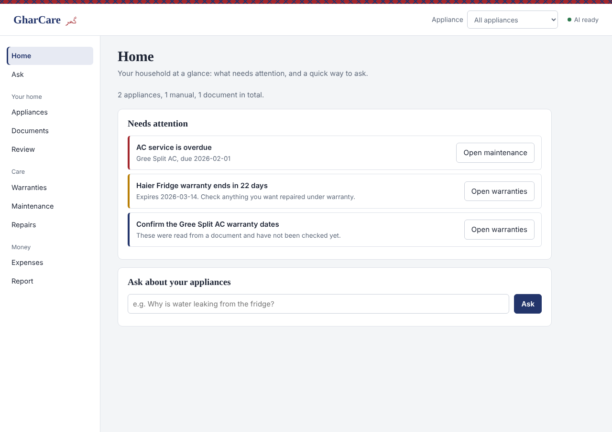
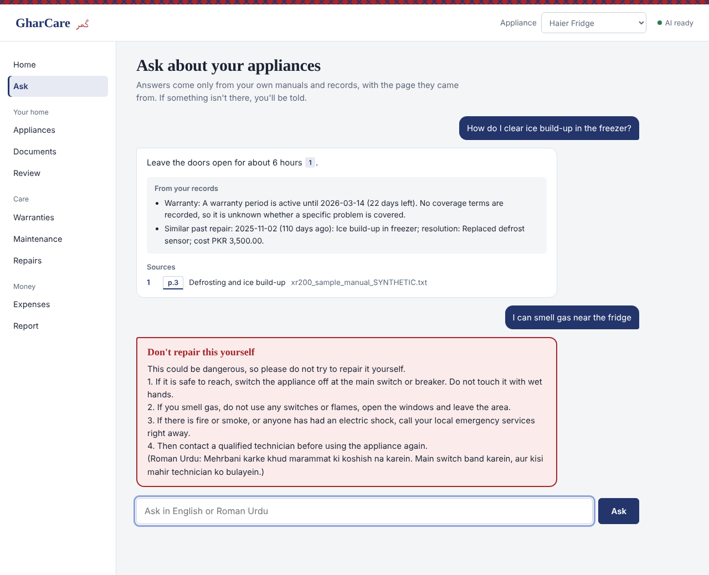

# GharCare AI

[](https://github.com/tahirshamim/gharcareAi-household-assistant/actions/workflows/tests.yml)

A multilingual household assistant for appliances, manuals, warranties, maintenance, repairs and expenses, built for
households in Pakistan (English, Roman Urdu, Urdu). It answers only from your own documents and records, cites the
page every answer came from, and says so when the answer isn't there.

**On a real 34-page appliance manual with 42 hand-labeled questions: 29/33 answerable questions correct with a relevant
citation (87.9%, 95% CI 73-95%), 0 wrong citations, 9/9 unanswerable questions correctly refused.**

**Reviewers: start with [docs/CASE_STUDY.md](docs/CASE_STUDY.md).** AI engineering internship case study
(RAG + vector DB + LangGraph/LangChain + OOP + artifact storage).

| Home: what needs attention | Answer with records and page sources |
|---|---|
|  |  |

*Screenshots use the synthetic sample manual; the real manual used for evaluation is not redistributed.*

## Project status (honest view)

| Area | Status |
|---|---|
| Domain models + business rules (warranty expiry, overdue status, rescheduling) | **Done, tested** |
| SQLite repositories with per-user isolation | **Done, tested** |
| Artifact store (originals, versioned extractions, reports) | **Done, tested** |
| LLM provider interface, fake provider, retry/backoff | **Done, tested** |
| Chunking (page-exact, section-aware), BM25, hybrid fusion (RRF), ingestion pipeline, schema migration v1->v2 | **Done, tested** |
| Retrieval evaluation harness (hit rate@k, MRR, "I don't know" calibration signals) | **Done, tested** |
| End-to-end assistant evaluation (grounded-correct / wrong-citation / abstention / hallucination-risk rates with 95% CIs) | **Harness done and tested with fakes; real-model numbers come from `examples/eval_assistant.py`** |
| PDF text extraction (pypdf) | Written; tested on a generated PDF (needs `pypdf`) |
| Chroma vector store + sentence-transformers embeddings | **Verified on the user's machine**; measured on the real Gorenje manual (see below) |
| Warranty, maintenance, expense, repair-history context and report services (exact Decimal/date logic) | **Done, tested** |
| Maintenance service log (cost of completed work), atomic task completion, schema v3 | **Done, tested** |
| Document extraction (receipts, warranty cards, service invoices): rules + AI reader with evidence check, confidence, review, atomic confirm, measured accuracy | **Done, tested with a scripted fake LLM; rules verified on 3 synthetic documents** |
| Web app: FastAPI + single-page UI (chat with citations, documents, extraction review, warranties, maintenance, repairs, expenses, report) | **Redesigned UI (Home overview of what needs attention, grouped navigation, answer cards with separate records and page-tab sources, mobile layout). HTTP tests and real-browser tests (headless Chrome via Playwright) pass in the dev sandbox; on the user's machine the app was started and served, the new design has not been clicked through there yet** |
| Assistant workflow: safety screen, intent routing, appliance resolution, cited + verified answers, graceful degradation | **Done, tested with a scripted fake LLM** |
| LangGraph backend (same graph spec as the built-in runner) | **Verified on the user's machine** (parity test + live run) |
| Gemini / Ollama via LangChain adapter | **Gemini verified live**; Ollama written, never run. Calls are paced (GHARCARE_LLM_RPM, default 12/min) and per-minute 429s wait as long as Gemini asks |
| Computer vision / OCR for scanned receipts | Deferred (future `Extractor` implementation) |

## Run

```bash
PYTHONPATH=src python -m unittest discover -s tests -t .     # 357 tests; Chroma/PDF/LangGraph tests auto-skip if their package is missing
PYTHONPATH=src python examples/demo_foundation.py            # Step 1: appliances/warranties/repairs story
PYTHONPATH=src python examples/demo_rag.py                   # Step 2: ingest + cited retrieval + evaluation (offline baseline)
PYTHONPATH=src python examples/demo_services.py              # Step 3: exact answers (warranties, overdue, spend, report)
PYTHONPATH=src python examples/demo_assistant.py             # Step 4: the full assistant (uses .env; offline stand-in if no key)
python examples/demo_extraction.py                           # Step 5: read documents, review, confirm, accuracy (add --llm for the AI reader)
python examples/eval_assistant.py --out results.json         # end-to-end evaluation with the REAL model (needs .env)
```
(With pytest installed, `pytest` also works.)

### Verifying the real RAG stack (Chroma + multilingual embeddings)

```bash
pip install -r requirements-rag.txt        # downloads torch + chromadb; the embedding model downloads on first use
PYTHONPATH=src python -m unittest tests.test_vectorstore tests.test_pdf_extraction -v   # Chroma contract + PDF tests now RUN
PYTHONPATH=src python examples/demo_rag.py --embedder sentence-transformers --vector-store chroma
```
Compare the two evaluation reports: the baseline (lexical hashing) vs the real model is your first
measurable result.

## Run the web app

```powershell
pip install -e .
pip install -r requirements-app.txt
python -m gharcare.doctor            # optional check
python -m gharcare.api               # then open http://127.0.0.1:8000
```
Try it: add an appliance, upload `examples/sample_docs/xr200_sample_manual_SYNTHETIC.txt` (type *manual*), ask "How do I clear
ice build-up in the freezer?"; upload `receipt_SYNTHETIC.txt` (type *receipt*) and press *Extract details*, then review.
The app listens on this computer only; set `GHARCARE_APP_TOKEN` in `.env` before exposing it to a network (it refuses otherwise).
Architecture, measured results and limitations: `docs/ARCHITECTURE.md`.

## Configuration (.env)

```powershell
Copy-Item .env.example .env       # then:  notepad .env   -> paste GEMINI_API_KEY and set GHARCARE_LLM_MODEL
python -m gharcare.doctor         # checks the setup; never prints your key
```
`.env` is loaded automatically by the demos (real environment variables win over the file; empty values are
ignored). It is git-ignored: never commit or share it. Watch out: Notepad may save it as `.env.txt` (the doctor detects this).

## Architecture (Step 1)

```
src/gharcare/
  domain/        frozen dataclasses + rules: Appliance, Warranty, MaintenanceTask, RepairRecord, Document
  repositories/  abstract interfaces (base.py) + SQLite implementation (sqlite.py)
  storage/       ArtifactStore (abstract) -> LocalArtifactStore
  llm/           LLMProvider (abstract), FakeLLMProvider, RetryingLLMProvider
  ingestion/     extractors (txt, pdf), Chunker, IngestionService (upload -> index, with rollback)
  retrieval/     tokenizer, BM25, embedders, VectorStore (in-memory, Chroma), HybridRetriever
  evaluation/    labeled retrieval evaluation (hit rate, MRR, threshold-calibration signals)
  workflow/      safety screen, intent rules, appliance resolver, graph spec (+ LangGraph / local runners), HouseholdAssistant
  extraction/    rules, AI reader + evidence check, review service (propose / confirm / reject / accuracy)
  api/           AppService (framework-free), FastAPI shell (app.py), static web page, `python -m gharcare.api`
  rag.py         wires ingestion + retrieval onto the container
  services/      WarrantyService, MaintenanceService, ExpenseService, ApplianceContextService, ReportService
                 (plain Python; build_services() wires them with one shared clock)
  config.py      Settings (from environment, no secrets)
  container.py   composition root: the only place concrete classes are wired together
  errors.py      one exception hierarchy
```

## Design decisions

1. **Business rules in code, not prompts.** Warranty expiry, overdue status and money totals are
   deterministic Python. The LLM will explain results, never compute them.
2. **Repositories are interfaces.** Services and the future LangGraph nodes depend on the abstract
   classes, so storage can change or be mocked without touching logic.
3. **User isolation at the data layer.** Every query is scoped by `user_id`; another user's record is
   reported as "not found". Child records cannot be attached to another user's appliance.
4. **Originals are immutable and content-addressed.** SHA-256 naming gives free deduplication; files are
   read-only and written atomically. User-supplied filenames never reach the filesystem path.
5. **Extractions are versioned.** The raw AI output and every user correction are separate files, so
   extraction accuracy can later be measured from the gap between them.
6. **Appliance links live in the database, not in file paths.** One manual can serve two identical ACs
   and re-assigning a document never moves files.
7. **Deleting an appliance keeps its documents** (link cleared) because they are the user's originals.
8. **Unknown stays unknown.** `RepairRecord.covered_by_warranty` is `None` when not known, never guessed.
9. **Standard library only for the core**, so it is verifiable without installing anything; the real
   RAG stack (Chroma, sentence-transformers, pypdf) is optional and lives behind interfaces.
10. **SQLite is the source of truth for chunk text; the vector DB only holds embeddings.** The vector
    index can be dropped and rebuilt (`reindex`) at any time.
11. **Chunks never cross page or heading boundaries**, so every citation (file, page, section) is exact.
12. **Hybrid retrieval**: vectors for meaning, BM25 for exact tokens (error codes, model numbers),
    fused with Reciprocal Rank Fusion. Absolute scores are kept on every result because fused rank
    scores cannot say "nothing relevant was found".
13. **Ingestion never leaves a half-searchable document.** Failures roll back chunks and vectors and
    mark the document FAILED; `reindex()` retries without re-uploading.
14. **Evaluation is chunk-level**: a labeled question can require an evidence phrase, so "right page,
    wrong chunk" does not count as a hit.

15. **Numbers come from code, never the LLM.** Totals, expiry dates and overdue counts are Decimal/date
    arithmetic over saved records, with hand-computed expected values in the tests.
16. **Gaps are reported, not hidden.** A cost of 0 is ambiguous, so zero-cost records, missing prices and
    unconfirmed warranties are counted and surfaced ("totals may be understated").
17. **Warranty period is not fault coverage.** Coverage answers state the dates and say when terms are not
    recorded; they never claim a specific problem is covered.
18. **Multi-step writes are atomic.** Completing a task logs the work AND reschedules it in one transaction.

19. **Safety is deterministic and runs first.** A keyword screen (English, Roman Urdu, Urdu) escalates before any
    model call, so it works when the LLM is down and cannot be argued out of it.
20. **The LLM has three narrow jobs**: classify unclear messages, write a troubleshooting answer from numbered
    excerpts, and judge whether that answer is supported. Warranty, maintenance, expense and report answers are
    deterministic. The model may reply NOT_FOUND, and uncited, mis-cited or unsupported answers are replaced by raw passages.
21. **Ambiguity is asked about, never guessed**: several matching appliances (e.g. two ACs) triggers a question.
22. **Graceful degradation**: if the LLM is unavailable, the user still gets the cited manual passages.
23. **One graph spec, two executors** (LangGraph and a built-in runner), so logic is tested offline and the
    LangGraph wiring is checked by a parity test on your machine.

24. **The AI reader cannot introduce values.** Every value it proposes must appear in the document text (dates, amounts
    and durations are matched against those found in it); otherwise it is discarded. Two readers agreeing raises
    confidence; disagreeing lowers it and lists the other reading.
25. **Nothing is saved until the user confirms**, uncertain fields must be explicitly reviewed (or changed), and
    confirmation is one atomic transaction. The AI draft and the user's final values are both stored, so field-level
    accuracy is measured, not assumed.
26. **Documents reuse existing appliances**: matched by serial number, or by brand+model only when exactly one matches.

## First measured results (offline lexical baseline)

27 labeled questions (18 answerable, 9 unanswerable) on a 5-page SYNTHETIC manual, hashing embedder (a lexical
baseline, not a semantic model): hit rate@1 0.78, @3 0.83, @5 1.00, MRR 0.835. Weak spots are vocabulary mismatches
("fridge" vs "refrigerator", "frost" vs "ice") and a Roman Urdu question over an English passage, which a semantic
model should improve (run `examples/demo_rag.py --embedder sentence-transformers --vector-store chroma` to compare).
For unanswerable questions the best vector similarity (max 0.282) and BM25 score (max 4.5) overlap the answerable
range (min 0.124 / 2.5), so a simple score threshold cannot separate them. That is why Step 4 uses an LLM grounding
check. These numbers come from a small synthetic set: they show the harness works, not how real manuals will perform.

## Known limitations

* No users table or authentication yet; `user_id` is a plain string (demo mode).
* One shared SQLite connection behind a lock: fine for a demo, not for heavy concurrency.
* Schema is versioned (v1) but there are no migrations yet.
* Artifacts are never deleted by the application (no retention/erase feature yet).
* Currency is assumed to be PKR; there is no multi-currency support.
* Test suite confirmed passing on Windows after one path-comparison fix; read-only file permissions
  (`0o444`) still behave differently across operating systems.
* Verified on Python 3.12 only (declared support: 3.10+).
* During development, use sample/synthetic documents only if you use a free cloud LLM tier,
  because free-tier terms may allow provider use of submitted data.
* Step 2: heading detection is a heuristic (ALL-CAPS lines, standalone numbered lines); unusual manual
  layouts may be sectioned imperfectly. No chunk overlap, no table-structure extraction.
* Scanned/image-only PDFs cannot be indexed (no OCR); they are stored and reported with a warning.
* BM25 is rebuilt per query from the user's chunks (fine for household scale, not for huge corpora).
* The same file linked to two appliances is indexed twice (duplicate chunks), by design for simplicity.
* The Chroma adapter and the sentence-transformers embedder are unverified until you run the contract
  tests above; Chroma's API changes between versions.
* Step 3: similar-repair detection is a keyword heuristic (Dice overlap); it can miss paraphrases such as
  'frost' vs 'ice'. Matches must be presented as 'similar', not proof of the same fault.
* A repair/service cost of 0 cannot be told apart from 'not recorded'; it is counted as a data gap.
* Expense categories are purchases, repairs and maintenance only; no utility or consumable costs.
* Reports are Markdown only (PDF export is a later step).
* Step 4: the safety screen is keyword-based and will miss unusual phrasings; the prompt also tells the model to
  escalate dangerous steps, but neither is a guarantee. The wording is generic (no country-specific emergency numbers).
* Grounding quality (does the real model say NOT_FOUND when it should? does the judge catch bad claims?) is NOT measured
  yet. It needs an end-to-end evaluation with a real model and real manuals (next step).
* Similar-repair matching is keyword-based with a small English / Roman Urdu / Urdu glossary ("barf" matches "ice"); paraphrases outside it are missed.
* With several appliances, a question that names none gets a clarification question; the UI should pass `appliance_id`.
* Fixed at temperature 0 when the chat model is built; per-call temperature/max_tokens are not forwarded.
* Gemini free-tier terms may allow provider use of submitted data; use sample documents only while on that tier.
* The end-to-end evaluation scores citations at the (document, page) level and uses a single SYNTHETIC 5-page manual
  with 27 questions, so confidence intervals are wide; real manuals and more questions are needed for firm claims.
* Free-tier Gemini quotas are small, per model and per project (one observed limit: 20 requests/day), and Google no longer
  publishes them; check the AI Studio rate-limit console. A daily quota is reported as its own non-retried error
  (LLMQuotaExhaustedError). The end-to-end evaluation caches answers (resume later), stops early on repeated failures and
  accepts `--max-calls`. A full run needs roughly 60-70 calls.
* Some Gemini models (e.g. Flash-Lite) ignore temperature=0, so answers can differ slightly between runs; the evaluation's
  answer cache pins a run for reproducibility. A hazard question that is also answerable from the manual is escalated by the
  deterministic safety screen instead of being answered from the manual (reported separately, by design).
* Step 5: the rules were tuned on three SYNTHETIC documents (20/20 fields); real Pakistani receipts will have layouts they miss.
  Missed fields are left empty/LOW for the user to fill, never guessed. Scanned or photographed receipts are not supported
  (no OCR); text-based PDFs and .txt only.
* Ambiguous day/month dates are read day-first and always flagged for review. Component warranties (e.g. a longer compressor
  warranty) are shown as conflicting durations for the user to choose, not silently resolved.
* The AI reader has only been tested with a scripted fake model so far; run `examples/demo_extraction.py --llm` to try it live.
* Step 6: browser tests (`tests/test_browser.py`) need `pip install -r requirements-dev.txt` and a Chromium (`python -m
  playwright install chromium`); HTTP tests need `pip install -r requirements-app.txt`. Single local user with an optional
  shared access token (no accounts).

## Testing with a real manual (Gorenje 590939)

Put the PDF at `examples/real_docs/590939.pdf` (git-ignored, never shipped), then:
```powershell
python examples/eval_retrieval.py --manual examples/real_docs/590939.pdf --questions examples/sample_docs/eval_questions_gorenje.json
python examples/eval_retrieval.py --manual examples/real_docs/590939.pdf --questions examples/sample_docs/eval_questions_gorenje.json --embedder sentence-transformers --vector-store chroma
python examples/eval_assistant.py --manual examples/real_docs/590939.pdf --questions examples/sample_docs/eval_questions_gorenje.json --embedder sentence-transformers --vector-store chroma --max-calls 90 --out gorenje_results.json
```
Final results on this manual (Step 7 code, Gemini Flash-Lite, multilingual-e5-small + Chroma, LangGraph):
retrieval hit@4 0.91 (hit@1 0.58, MRR 0.709); end-to-end 29/33 answerable correct with a relevant citation (87.9%,
95% CI 73-95%), 0 wrong citations, 9/9 unanswerable correctly refused, 1.3 LLM calls per question.
Details, the before/after table and the remaining misses: [docs/CASE_STUDY.md](docs/CASE_STUDY.md).
`examples/inspect_cases.py` replays the cached run (no LLM calls) to show retrieval, draft and judge output for each miss.

An earlier lexical-baseline run (older code) gave hit@1 0.52, @3 0.73, @5 0.79, MRR 0.623. The 42 labels were
verified against the PDF text (every evidence phrase appears on the labeled pages).
