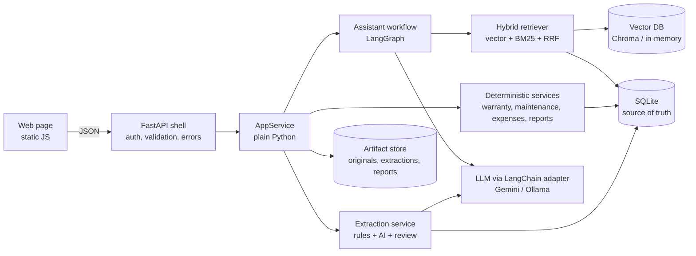
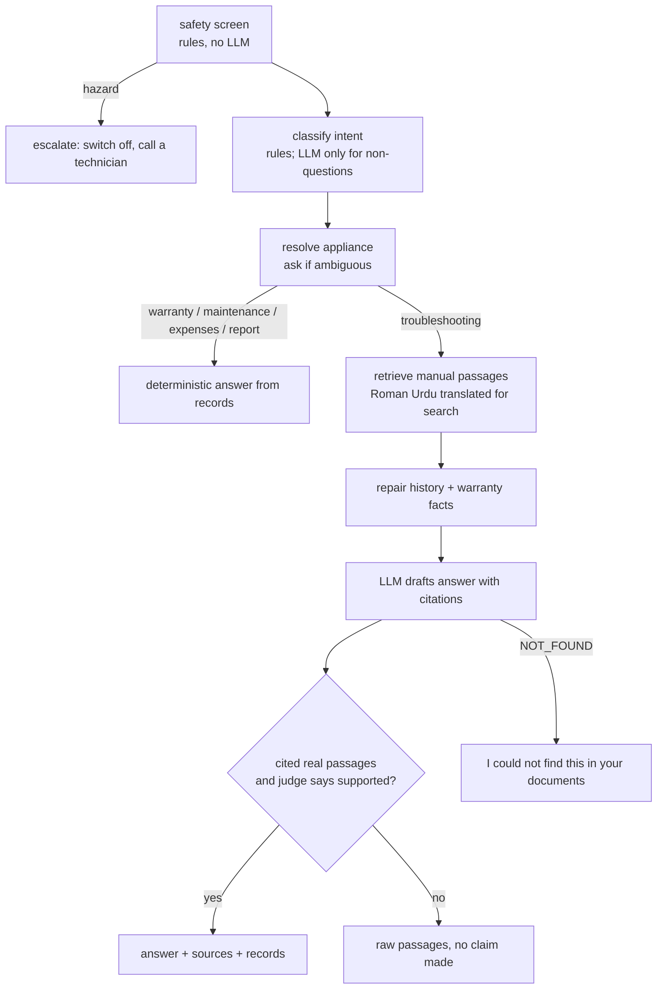
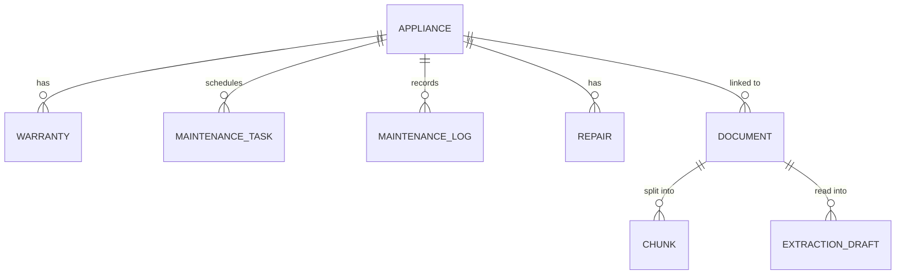

# GharCare AI: architecture, results and limitations

AI-assisted household appliance manager (manuals, receipts, warranties, maintenance, repairs, expenses) for Pakistani
households: English, Roman Urdu and Urdu script where practical. Built as an AI engineering internship case study.
**All results below come from small SYNTHETIC documents; they show the evaluation method works, not real-world accuracy.**

## 1. System overview

Layering (OOP): domain entities (frozen dataclasses with validation) -> repository interfaces + SQLite implementations ->
services (business rules) -> workflow / extraction -> `AppService` -> HTTP. Concrete classes are chosen in one place
(`container.py`, `rag.py`, `AppService.create`); everything else receives dependencies through constructors.

## 2. How a question is answered (LangGraph)

The LLM has four narrow jobs (unclear-intent fallback, translating a Roman Urdu / Urdu question for search, drafting a cited answer, judging support and naming the supporting passages). Totals, dates and
statuses come from code, never the model. If no LLM is available the app still answers record questions and shows
cited passages.

## 3. Data and artifacts

* Originals: content-addressed, read-only, deduplicated by SHA-256, filename never used as a path.
* `extracted/<doc>/vNNNN.json` (page text) and `extracted/<doc>-fields/vNNNN.json` (AI draft, then user-confirmed values);
  versions are never overwritten. Reports are Markdown files that are never overwritten.
* The vector index only holds embeddings; chunk text lives in SQLite, so the index can be rebuilt at any time (done on start-up for the in-memory store).
* Schema is versioned with in-place migrations (currently v4).

## 4. Key design decisions

| Decision | Why |
|---|---|
| Exact answers from code, not the LLM | Money and dates must be exact and auditable |
| Safety screen before any model call | Works when the LLM is down; cannot be talked out of escalating |
| Hybrid retrieval (vectors + BM25, RRF) | Error codes and model numbers are exact tokens; embeddings alone miss them |
| Chunks never cross a page or heading | Citations (file, page, section) are exact |
| Answer must cite real passages and pass a judge | Uncited or unsupported answers are replaced by raw passages |
| AI extraction values must appear in the document | The model cannot introduce a value that is not there |
| Agreement of readers is not always independent | An ambiguous date stays "medium" even when both readers guess day-first |
| Nothing saved until the user confirms; atomic save | Users review and correct; no half-written records |
| Per-user scoping at the data layer | Another user's record is "not found", IDs cannot be probed |

## 5. Measured results (synthetic data, small samples)

| Component | Data | Result |
|---|---|---|
| Retrieval, lexical baseline (hashing) | 27 labeled questions, 5-page manual | hit rate@1 0.78, @3 0.83, @5 1.00, MRR 0.835 |
| Retrieval, lexical baseline, **REAL 34-page Gorenje manual** | 42 labeled questions (33 answerable, 9 unanswerable) | hit rate@1 0.52, @3 0.73, @5 0.79, MRR 0.623. Much harder than the synthetic manual: misses are mostly vocabulary mismatches ('stand upright' vs 'rest in a vertical position', centre/center) and Roman Urdu questions over English text. Semantic embedder measured below |
| Retrieval, **semantic** (multilingual-e5-small + Chroma), REAL Gorenje manual | same 42 questions | hit rate@1 0.70, @3 0.85, @5 0.91, MRR 0.788. Remaining misses: one vocabulary gap ('information for the service centre') and both Roman Urdu questions |
| End-to-end, Gemini Flash-Lite, REAL manual, **partial** (20 of 42, call budget) | 20 answerable | 11 correct, 0 wrong citations, 1 unverified, 1 abstained, 1 safety escalation, 6 routed to the wrong intent ('how much space' -> expenses; LLM classifier -> help). Routing fixed afterwards; numbers to be re-measured |
| End-to-end, Gemini Flash-Lite, REAL manual, **full run after routing fix** | 33 answerable + 9 unanswerable | answerable: 25 correct (75.8%, CI 59-87%), 0 wrong citations (CI 0-10%), 3 unverified, 4 abstained (2 Roman Urdu), 1 safety escalation by design. Unanswerable: 9/9 refused, 0 hallucinated (CI 0-30%) |
| **Final (Step 7)**: retrieval, REAL manual, e5 + Chroma | 33 answerable | hit@1 0.58, @3 0.82, **@4 0.91**, @5 0.91, MRR 0.709 (60 chunks; earlier rows used other code versions and are not directly comparable) |
| **Final (Step 7)**: end-to-end, Gemini Flash-Lite, REAL manual | 33 answerable + 9 unanswerable | **29/33 correct (87.9%, CI 73-95%)**, 0 wrong citations, 1 unverified, 2 abstained, 1 safety escalation; 9/9 refused, 0 hallucinated; 1.3 calls/question |
| Assistant end to end, Gemini Flash-Lite, answerable | 18 questions | 16 correct with a relevant citation (88.9%, 95% CI 67-97%), 0 wrong citations, 1 safety escalation (by design), 1 missed (Roman Urdu question over an English passage) |
| Assistant end to end, unanswerable | 9 questions | 9 correctly refused (100%, 95% CI 70-100%), 0 hallucinated answers |
| Extraction, rules | 3 synthetic documents, 20 labeled fields | 20/20 values; ambiguous date flagged for review |
| Extraction, AI reader (live) | same documents | agreed with the rules on all fields except a harmless store-name variant; ambiguous-date handling fixed after this run |
| Tests | whole project | 317 automated tests; deliberate-bug (mutation) checks on the critical logic |

Reading these honestly: with 18 and 9 questions the confidence intervals are wide, the documents are synthetic, and the
manual was written by us. The embedding model used for the end-to-end run was the lexical baseline; a semantic model
(sentence-transformers + Chroma) is supported and should be compared on the same question set.

## 6. Limitations

* Inspecting the 7 real-manual misses (examples/inspect_cases.py) found: (1) reserved slots could fill all k=4 places and evict the best
  fused chunk (2 misses) - now at most k//2 slots are reserved; (2) the retrieval evaluation sliced a k=5 list, so it never measured the
  assistant's k=4 - it now retrieves at each k; (3) '[2, 3]' citations were rejected; (4) a correct but uncited draft was discarded -
  the judge now names supporting excerpts, used only when the draft cites none; (5) the judge rejected the safety advice our own prompt
  requires; (6) Roman Urdu questions searched an English manual untranslated - they are now translated for search only (1 extra call).
* Real-manual findings (Gorenje 590939): running footers, wrapped headings and stray diagram labels polluted chunks and were fixed; a table-of-contents page and some adjacent headings still merge into long section names.
* Rank fusion alone could bury a perfect keyword match, so the best two results of each retriever are now guaranteed a place.
* Synthetic documents only; real manuals and receipts will expose layouts the chunker and extraction rules miss.
* No OCR / computer vision: scanned or photographed documents are stored but not searchable or extractable.
* Single local user (configurable id) with an optional access token; no accounts, passwords or per-user login.
* Free LLM tiers have small, per-model daily quotas and may use submitted data; a production deployment needs a paid key or a local model.
* Safety screen is keyword-based and will miss unusual phrasings; it is a safeguard, not a guarantee.
* Similar-repair matching is keyword-based with a small English / Roman Urdu / Urdu glossary ("barf" now matches "ice"); paraphrases outside the glossary are missed. It is not semantic matching.
* The web page has been checked by syntax, safety and API-contract tests, not by automated browser tests.
